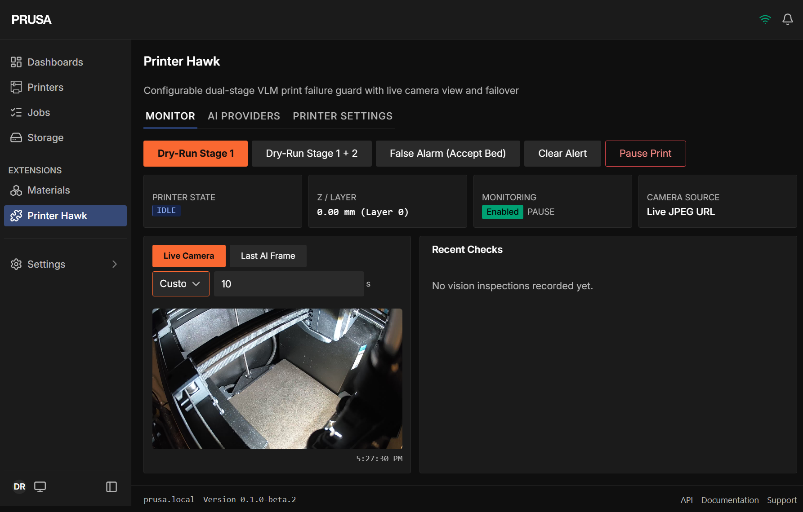
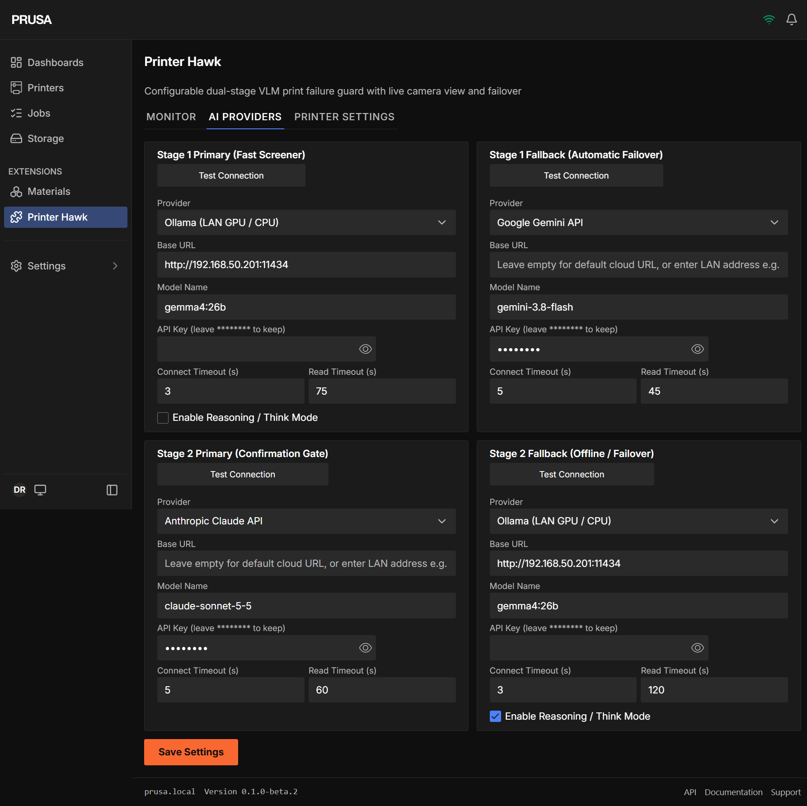
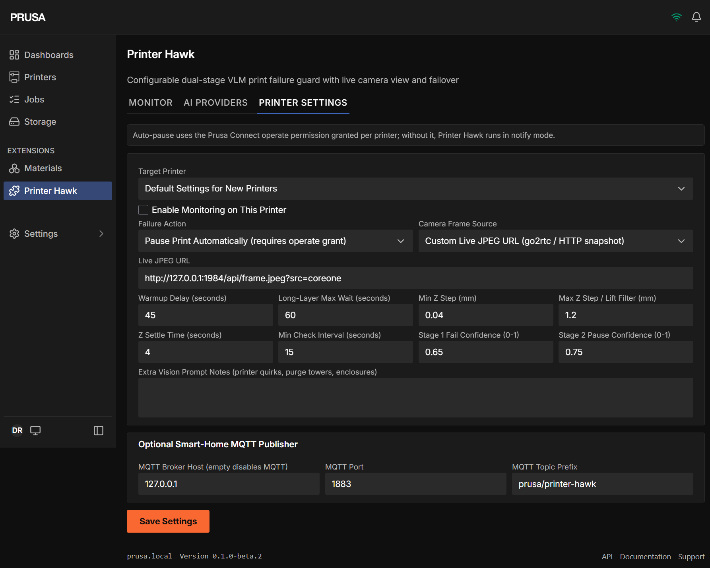

# Printer Hawk — Dual-Stage VLM Print Failure Guard for Prusa Connect Local

**Printer Hawk** is a native Prusa Connect Local extension (`com.github.aux.ln4cy.printer-hawk`) that monitors 3D prints with Vision-Language Models (VLMs) instead of single-frame spaghetti-only heuristics. It works with **any combination** of local GPU/CPU inference (**Ollama**, **LM Studio**, **vLLM**, **llama.cpp**) and cloud APIs (**Gemini**, **Anthropic Claude**, **OpenAI / OpenRouter**), with automatic Primary -> Fallback failover.

## Key Features

- **Dual-Stage AI Verification (with Failover):**
  - **Stage 1 (Fast Screener):** Runs on every settled layer change (or fallback timer) with previous + current frames and live printer telemetry (Z height, nozzle/bed temperatures, progress). Automatically fails over from **Stage 1 Primary -> Stage 1 Fallback** if the primary is unreachable or busy.
  - **Stage 2 (Confirmation Gate):** Triggered only when Stage 1 flags a failure or repeated warnings (`Warnings Before Stage 2`). Compares earlier bed baseline + previous clean + current frames to rule out supports, purge towers, glossy reflections, or shadows before pausing. Supports **Stage 2 Primary -> Stage 2 Fallback** or single-stage operation when Stage 2 is set to `Disabled (none)`.
- **Per-Layer Z Tracking (Toolchanger & Z-Hop Safe):**
  - Ignores short Z-hops and large multi-tool travel lifts (`Z > ConfirmedZ + Max Z Step`).
  - Re-baselines cleanly downward if warmup finishes while parked high (for example `Z = 40 mm`) before Layer 1.
  - Falls back to a configurable `Long-Layer Max Wait` timer (default `60s`) during wide or slow layers.
- **Flexible Camera Sources:**
  - **Prusa Connect Snapshots:** Reads stored frames natively via `core-storage.read` (`com.prusa.connect.camera.snapshot.captured`).
  - **Custom Live JPEG URL (`go2rtc` / HTTP):** Pulls live JPEGs directly from an HTTP snapshot endpoint (such as a single-connection `go2rtc` RTSP relay on `http://127.0.0.1:1984/api/frame.jpeg?src=coreone`), with automatic fallback to Prusa Connect snapshots on error.
- **Native UI Controls & Stored Frame History:**
  - Available both as a fleet-wide **Printer Hawk** sidebar page and as an embedded **Printer Hawk** tab on every printer page.
  - **Live Camera / Last AI Frame** toggle with configurable refresh rate (`1s`, `2s`, `5s`, `Custom`, `Paused`).
  - **False Alarm (Accept Bed)** promotes the current bed frame as the new clean baseline and clears the pause latch.
  - Rolling historical frames stored on disk so you can click **Inspect Frame** on any past check.
- **Event Bus & Optional MQTT Alerts:**
  - Emits `com.github.aux.ln4cy.printer-hawk.failure.detected` on Prusa Connect's event bus (works with downstream notification extensions).
  - Optional lightweight pure-Go MQTT publisher for smart-home integrations such as Homebridge / Apple Home or Home Assistant.

---

## Installation

### Option 1: From a Release Tarball (CLI)

1. Download the release archive (`printer-hawk_0.1.0.tar.gz`) or build `release/` with `make release`.
2. Copy the archive where `prusa_connect_local` can read it (for example `/tmp/printer-hawk-0.1.0.tar.gz` inside the container's `/tmp` volume), then run:

```sh
docker exec prusa_connect_local /prusa_connect module add \
  -config /config/config.yaml \
  -from /tmp/printer-hawk-0.1.0.tar.gz \
  -approve \
  github.com/ln4cy/printer-hawk@0.1.0
```

3. Restart `prusa_connect_local` so the core loads the new extension:

```sh
docker compose restart prusa-connect
```

> **Note on same-version upgrades:** If reinstalling or updating the same version (`0.1.0`), run `module remove sink:printer-hawk` before `module add`. Your runtime config is persisted in `<data_dir>/settings.json`.

---

## Quick Start & Operator Permissions (Auto-Pause)

1. Open Prusa Connect Local in your browser and select **Printer Hawk** in the sidebar.
2. Open the **AI Providers** tab, configure at least **Stage 1 Primary**, click **Test Connection** on each configured slot, and click **Save Settings**.
3. Open the **Printer Settings** tab, set your **Camera Frame Source** (see [Camera Setup via `go2rtc`](#camera-setup-via-go2rtc) below), enable **Enable Monitoring on This Printer**, choose **Failure Action**, and click **Save Settings**.
4. **Required for `Pause Print Automatically`:**
   - Installing with `-approve` grants `observe` and `read_storage` at the organization level, **not** printer control.
   - In Prusa Connect Local, open **Printers -> \<Your Printer\> -> Access** and grant `sink:printer-hawk` the **Operator** role on each printer you want Printer Hawk to pause automatically.
   - Without per-printer **Operator** permission, Printer Hawk still monitors, logs checks, emits bus/MQTT alerts, and operates in **Notify Only** mode without pausing the printer.

---

## User Guide

### 1. Monitor Tab (and Per-Printer Tab)



The **Monitor** tab (and the **Printer Hawk** tab inside each individual printer page) gives live operational control and check history:

- **Top Action Buttons:**
  - **Dry-Run Stage 1:** Captures the current camera frame right now and runs Stage 1 only (never pauses or latches an alert).
  - **Dry-Run Stage 1 + 2:** Forces both Stage 1 and Stage 2 verification on the current frame so you can test the confirmation pipeline without affecting an active print.
  - **False Alarm (Accept Bed):** Clears an active alert/latch and promotes the latest analyzed frame as the clean reference baseline for subsequent Stage 2 comparisons.
  - **Clear Alert:** Resets `FAILURE ALERT ACTIVE`, consecutive warning count, and per-job pause latch without changing the reference frame.
  - **Pause Print:** Manually sends `core.command.pause_print` to the connected printer (requires caller `operate` permission).
- **Status Cards:** Displays live **Printer State** (+ alert badge if active), **Z / Layer** (current Z, confirmed baseline Z, and layer count), **Monitoring** (`Enabled`/`Disabled` + `notify`/`pause`), and active **Camera Source**.
- **Camera Viewer:**
  - Switch between **Live Camera** (polls `/live.jpg` from your configured source) and **Last AI Frame** (shows the exact stored frame from the most recent check).
  - Use the refresh dropdown (`1s`, `2s`, `5s`, `Custom`, `Paused`) to tune live preview polling. Selecting **Custom** reveals a seconds box (minimum `0.5s`, default `10s`).
- **Recent Checks Table:** Shows timestamp, trigger (`layer_baseline`, `layer_advance`, `layer_rebaseline`, `timer_fallback`, `dry_run`), image source, Stage 1 & Stage 2 verdicts/models (including failover badges when fallback ran), action taken, and an **Inspect Frame** button to open the archived JPEG alongside the AI's reasoning.

---

### 2. AI Providers & Automatic Failover



The **AI Providers** tab lets you configure up to 4 independent slots. When a **Primary** slot times out or fails, Printer Hawk automatically fails over to its **Fallback** slot on the same check cycle:

- **Stage 1 Primary (Fast Screener):** Runs on every check trigger.
- **Stage 1 Fallback (Automatic Failover):** Used automatically if Stage 1 Primary is unreachable (for example, your desktop GPU PC is powered off).
- **Stage 2 Primary (Confirmation Gate):** Runs only when Stage 1 reaches `fail_confidence` (`Stage 1 Fail Confidence`) or accumulates `Warnings Before Stage 2` consecutive warnings.
- **Stage 2 Fallback (Offline / Failover):** Runs if Stage 2 Primary fails or is unreachable.

Supported provider types per slot:

| Provider | Notes |
| --- | --- |
| `Disabled (none)` | Disables that slot (setting Stage 2 Primary + Fallback to `none` runs single-stage mode). |
| `Ollama (LAN GPU / CPU)` | Enter Base URL (e.g. `http://192.168.1.50:11434`), model name (e.g. `gemma4:26b`), and optionally check **Enable Reasoning / Think Mode** (recommended `false` for fast Stage 1, `true` for careful Stage 2). |
| `Google Gemini API` | Enter model (e.g. `gemini-3.8-flash`) and API key (leave Base URL blank for default endpoint). |
| `Anthropic Claude API` | Enter model (e.g. `claude-sonnet-5-5`) and API key (leave Base URL blank for default endpoint). |
| `OpenAI-Compatible` | Works with OpenAI, OpenRouter, LM Studio, vLLM, or llama.cpp servers. |

Example combinations:

| Setup | Stage 1 Primary | Stage 1 Fallback | Stage 2 Primary | Stage 2 Fallback |
| --- | --- | --- | --- | --- |
| **Hybrid LAN GPU + Cloud** | Ollama (`gemma4:26b`, think off) | Gemini (`gemini-3.8-flash`) | Claude (`claude-sonnet-5-5`) | Ollama (`gemma4:26b`, think on) |
| **Local Only (Air-gapped)** | Ollama / LM Studio | Local VLM or `none` | Local reasoning VLM | `none` |
| **Cloud Only** | Gemini (`gemini-3.8-flash`) | OpenAI / OpenRouter | Claude (`claude-sonnet-5-5`) | `none` |
| **Single-Stage Fast** | Any VLM | Optional fallback | `none` | `none` |

Saved API keys are stored only on the server (`<data_dir>/settings.json`, `0600`) and are returned masked as `********`. Leaving `********` unchanged preserves the existing secret when saving settings.

---

### 3. Printer Settings, Z-Layer Tuning & MQTT



In **Printer Settings**, choose **Default Settings for New Printers** or select an individual printer from **Target Printer** to customize its behavior:

- **Failure Action:** `Notify Only` (UI badge, event bus, MQTT) or `Pause Print Automatically` (requires per-printer **Operator** grant).
- **Camera Frame Source:** Either `Prusa Connect Snapshots (native storage)` or `Custom Live JPEG URL (go2rtc / HTTP snapshot)`.
- **Layer & Cadence Tuning:**
  - `Warmup Delay (45s)`: Waits for initial homing/bed mesh/purge lines to finish before locking baseline Z.
  - `Min Z Step (0.04 mm)` / `Max Z Step / Lift Filter (1.2 mm)`: Ignores micro-jitter and multi-toolhead/park lifts without triggering false layer advances.
  - `Z Settle Time (4s)`: Waits after a Z change stabilizes before capturing a frame.
  - `Min Check Interval (15s)`: Minimum spacing between AI checks.
  - `Long-Layer Max Wait (60s)`: Fires a `timer_fallback` inspection when a single large layer takes longer than this duration.
- **Decision Thresholds & Prompt Notes:** Adjust `Stage 1 Fail Confidence` (default `0.65`), `Stage 2 Pause Confidence` (default `0.75`), and add **Extra Vision Prompt Notes** for printer-specific quirks (e.g., purge towers, textured PEI sheet, dark enclosure lighting, multi-toolhead parking).
- **Optional Smart-Home MQTT Publisher:** Set **MQTT Broker Host** (e.g. `127.0.0.1`), **Port** (`1883`), and **Topic Prefix** (default `prusa/printer-hawk`). Leave **MQTT Broker Host** blank to disable MQTT. When enabled, Printer Hawk publishes retained topics per printer:
  - `<prefix>/<printer_id>/printing` -> `ON` / `OFF`
  - `<prefix>/<printer_id>/alert` -> `ON` / `OFF`
  - `<prefix>/<printer_id>/status` -> JSON payload with latest Z/layer, Stage 1/2 verdict, and action taken.

---

## Camera Setup via `go2rtc`

### Why use `go2rtc`?

Embedded printer cameras such as the **Prusa Buddy3D camera** have limited RAM and CPU. Opening multiple simultaneous RTSP streams (Prusa Connect Live View + Homebridge/Home Assistant + an AI guard) or enabling Buddy3D **Print Timelapse (`Per Layer`)** alongside RTSP streaming can exhaust camera memory or leave the camera's HTTP `/snapshot.jpg` frozen on an older frame during long first layers.

Running a lightweight local **`go2rtc`** relay solves this by holding **one** RTSP connection to the camera and re-serving both RTSP video and on-demand live JPEG frames over localhost.

> **Buddy3D Camera Tip:** In the Buddy3D camera app/settings, turn **Print Timelapse** off (avoid `Per Layer` mode) when using RTSP + `go2rtc`, as the camera firmware uses extra RAM buffering per-layer stills alongside live video.

### Step A — Deploy `go2rtc` on the Prusa Connect Local Host (Raspberry Pi / Linux / Docker)

1. Create `go2rtc/go2rtc.yaml` next to your Prusa Connect Local `docker-compose.yml` (replace `192.168.1.99` with your camera's IP or RTSP URL):

```yaml
api:
  listen: "127.0.0.1:1984"

rtsp:
  listen: "127.0.0.1:8554"

webrtc:
  listen: ""

streams:
  coreone:
    - rtsp://192.168.1.99/live
    - ffmpeg:coreone#video=mjpeg
```

> **Why `- ffmpeg:coreone#video=mjpeg` matters:** `go2rtc`'s `/api/frame.jpeg?src=coreone` endpoint requires an MJPEG/transcode source (`ffmpeg:<stream>#video=mjpeg`) when the camera's native stream is H.264/H.265. Add extra streams under `streams:` if you have multiple printers (e.g. `mk4s`, `xl`).

2. Add the `camera-relay` service to your `docker-compose.yml` alongside `prusa-connect`:

```yaml
services:
  camera-relay:
    image: alexxit/go2rtc:latest
    container_name: prusa_camera_relay
    restart: unless-stopped
    network_mode: host
    volumes:
      - ./go2rtc/go2rtc.yaml:/config/go2rtc.yaml:ro
    healthcheck:
      test: ["CMD", "wget", "-q", "-O", "/dev/null", "http://127.0.0.1:1984/api"]
      interval: 30s
      timeout: 5s
      retries: 3
      start_period: 10s
```

<details>
<summary>Using bridge networking or a separate host for go2rtc?</summary>

- If `prusa-connect` is **not** using `network_mode: host`, bind `api.listen: ":1984"` and `rtsp.listen: ":8554"` on the shared Docker network and use the container service name (`http://camera-relay:1984/api/frame.jpeg?src=coreone` and `rtsp://camera-relay:8554/coreone`).
- If `go2rtc` runs on another machine on your LAN, bind `:1984` / `:8554` on that host and use its LAN IP instead of `127.0.0.1`. Keep `go2rtc` restricted to your LAN/VPN—do not expose it publicly.

</details>

3. Start `camera-relay` and verify both the stream and JPEG snapshot endpoint work on the Pi/host:

```sh
docker compose up -d camera-relay
curl -fsS http://127.0.0.1:1984/api/streams
curl -fsS -o /tmp/test-frame.jpg "http://127.0.0.1:1984/api/frame.jpeg?src=coreone" && file /tmp/test-frame.jpg
```

*(Note: Buddy3D cameras powered directly by the printer are only reachable while the printer is powered on.)*

### Step B — Configure the Camera in Prusa Connect Local

In the Prusa Connect Local web UI:

1. Go to **Printers -> \<Your Printer\> -> Cameras -> Add Camera** (or edit your existing camera) and choose **Generic**.
2. Set:
   - **Snapshot address:** `http://127.0.0.1:1984/api/frame.jpeg?src=coreone`
   - **Stream address:** `rtsp://127.0.0.1:8554/coreone`
3. Click **Save**.

Prusa Connect Local will now display live RTSP video and periodically capture snapshots from `go2rtc` without opening extra connections to the physical camera.

### Step C — Configure `go2rtc` in Printer Hawk

1. Open **Printer Hawk -> Printer Settings** in Prusa Connect Local.
2. Under **Target Printer**, select **Default Settings for New Printers** (and/or your specific printer).
3. Set **Camera Frame Source** to **Custom Live JPEG URL (go2rtc / HTTP snapshot)**.
4. Set **Live JPEG URL** to:

```text
http://127.0.0.1:1984/api/frame.jpeg?src=coreone
```

*(Double-check the stream name after `src=` matches `go2rtc.yaml` exactly.)*

5. Click **Save Settings**.

Supported ports for `live_frame_url` egress in [module.yaml](module.yaml) are `80`, `443`, `1984`, `5000`, `8080`, and `8091`. When **Custom Live JPEG URL** is active, Printer Hawk fetches fresh live frames from `go2rtc` for both AI inspections and the Monitor preview, and falls back to Prusa Connect's stored snapshots if the URL is temporarily unreachable.

---

## Troubleshooting

- **Printer Hawk logs failures but does not pause the printer:** Verify **Failure Action** is set to `Pause Print Automatically` in **Printer Settings** and that `sink:printer-hawk` holds the **Operator** role under **Printers -> \<Printer\> -> Access**.
- **Camera frame unavailable / timeout:** Make sure the printer (and Buddy3D camera) is powered on, check `curl -fsS -o /dev/null -w '%{http_code}\n' "http://127.0.0.1:1984/api/frame.jpeg?src=coreone"` returns `200`, and verify the `src=` parameter matches the stream key in `go2rtc.yaml`.
- **Stage 1 Primary times out when GPU workstation is asleep:** Configure **Stage 1 Fallback** (e.g. `gemini-3.8-flash`) with a `2s–3s` **Connect Timeout** on Stage 1 Primary so Printer Hawk fails over quickly without stalling checks.

---

## Building from Source

```sh
make check    # Fetch SDK (.core/), generate/check OpenAPI client, run Go & Svelte checks
make release  # Build linux_amd64, linux_arm64, darwin_arm64, windows_amd64 + ui/dist
```
